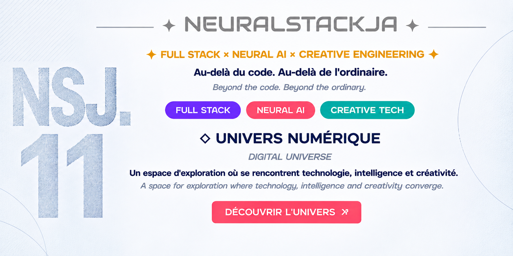

<!-- BANNIÈRE NEURALSTACKJA -->

---

---

<h2>01 / IDENTITÉ NUMÉRIQUE</h2>

<i>DIGITAL IDENTITY</i>

<h3>◈ Développeur indépendant & créateur numérique</h3>

<i>Independent Developer & Digital Creator</i>

Une approche multidisciplinaire où le développement logiciel,
l'intelligence artificielle et la création visuelle se rejoignent
pour concevoir des expériences numériques innovantes.

<i>
A multidisciplinary approach combining software development,
artificial intelligence and visual creativity to build
innovative digital experiences.
</i>

 

<h3>◇ DOMAINES D'EXPERTISE</h3>

<table width="100%">
<tr>
<td width="50%" valign="top">

 
<b>01 / SOFTWARE ENGINEERING</b>
 
Applications, architectures et interfaces
  
</td>
<td width="50%" valign="top">

 
<b>02 / NEURAL AI</b>
 
IA, réseaux neuronaux et automatisation
  
</td>
</tr>

<tr>
<td valign="top">

 
<b>03 / DATA ENGINEERING</b>
 
Données, API et visualisation
  
</td>
<td valign="top">

 
<b>04 / CREATIVE COMPUTING</b>
 
Programmation et expériences interactives
  
</td>
</tr>

<tr>
<td valign="top">

 
<b>05 / MOTION DESIGN</b>
 
Animation, vidéo et effets visuels
  
</td>
<td valign="top">

 
<b>06 / DIGITAL MEDIA</b>
 
Design graphique et multimédia
  
</td>
</tr>
</table>

 

<strong>Imaginer. Concevoir. Expérimenter. Évoluer.</strong>
 
<i>Imagine. Design. Experiment. Evolve.</i>

<h2>02 / LANGAGES DE PROGRAMMATION</h2>

<i>PROGRAMMING LANGUAGES</i>

<h3>◈ LANGAGES PRINCIPAUX</h3>

 

 

<h3>◇ AUTRES LANGAGES & TECHNOLOGIES</h3>

  

<code>LINGO</code> · <code>CLASS</code>

<h2>03 / INGÉNIERIE & CRÉATIVITÉ</h2>

<i>ENGINEERING & CREATIVITY</i>

 

<table width="100%">
<tr>
<td width="50%" valign="top">

 
<b>01 / SOFTWARE ENGINEERING</b>
 
Développement d'applications et architectures logicielles
  
</td>

<td width="50%" valign="top">

 
<b>02 / NEURAL AI</b>
 
Intelligence artificielle et systèmes intelligents
  
</td>
</tr>

<tr>
<td valign="top">

 
<b>03 / DATA ENGINEERING</b>
 
Données, automatisation et visualisations
  
</td>

<td valign="top">

 
<b>04 / CREATIVE CODING</b>
 
Programmation graphique et expériences interactives
  
</td>
</tr>

<tr>
<td valign="top">

 
<b>05 / JAVASCRIPT ANIMATION</b>
 
SVG, Canvas, WebGL, Three.js et animations web
  
</td>

<td valign="top">

 
<b>06 / DIGITAL MEDIA</b>
 
Montage vidéo, postproduction et effets visuels
  
</td>
</tr>
</table>

 

<h2>04 / DESIGN & CRÉATION NUMÉRIQUE</h2>

<i>DESIGN & DIGITAL CREATION</i>

<h3>✦ ADOBE CREATIVE SUITE</h3>

 

<b>Compétences créatives</b>

- Maîtrise d'Adobe Creative Suite
- Anciennes certifications Adobe
- Création graphique et composition visuelle
- Montage vidéo et postproduction
- Motion design et effets visuels
- Animations interactives en JavaScript
- Interfaces et expériences numériques

<h2>05 / TECHNOLOGIES CRÉATIVES</h2>

<i>CREATIVE TECHNOLOGIES</i>

 

<!-- NEURALSTACKJA — FOOTER -->

<strong>Créer sans limites. Explorer de nouvelles possibilités.</strong> 
<i>Create without limits. Explore new possibilities.</i>

<code>IMAGINER</code> /
<code>CRÉER</code> /
<code>INNOVER</code> 
<i>IMAGINE / CREATE / INNOVATE</i>

